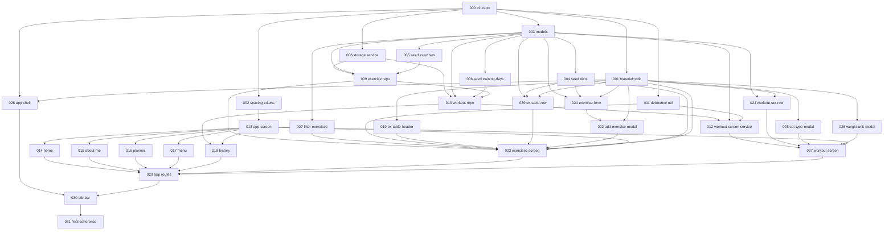

# PLAN.md — Plan migracji myGym (React Native + Expo → Angular)

> Autor: Planner. Rośnie w miarę migracji (PROCESS.md §9).
> Źródło: to repo (READ-ONLY). Cel: `../myGym-angular`.
> Konwencje wiążące: MAPPING.md §4. Decyzje wiążące: DECISIONS.md (D1–D10, zaakceptowane).
> **NAZEWNICTWO (D9/A, Angular 22):** ścieżki docelowe w krokach poniżej zapisane są
> miejscami ze starymi suffiksami (`*.component.ts`, `*.service.ts`, `*.model.ts`,
> `*.repository.ts`) — czytaj je BEZ suffiksu typu wg MAPPING §4: `home.ts`,
> `workout-screen.ts`, `exercise.ts`, `exercise-repository.ts`. Wiążące jest MAPPING §4.
> Numeracja kroków GLOBALNA, rosnąca (PROCESS.md §12). Commit per krok:
> `Migration-AI-step-NNN-krotki-opis-kebab-case`.

## Legenda

- **id** — trzycyfrowy, globalny numer kroku.
- **ZALEŻNOŚCI** — kroki, które MUSZĄ mieć status `done`, zanim ten ruszy.
- **KRYTERIA AKCEPTACJI** — sprawdzalne warunki „DONE" (PROCESS.md §5). Minimum
  zawsze: `ng build`/`tsc --noEmit` zielone, brak nowych błędów lintera, brak `any`,
  brak `// @ts-ignore`, zgodność z konwencjami MAPPING.md, commit wg PROCESS.md §12.
  Poniżej wymieniam dodatkowe, specyficzne kryteria danego kroku.

---

## CHECKPOINT CP1 — Rdzeń bez UI (modele, dane seed, czyste funkcje, storage, repozytoria)

### 000 — Inicjalizacja repo Angular

- **Opis:** Utworzenie pustego projektu Angular przez `ng new ../myGym-angular`
  (najnowszy stabilny, min. v20+ — D8). Standalone, signals, nowy control flow,
  builder esbuild/vite, SCSS jako format stylów, `strict: true` w `tsconfig.json`.
  Przypięcie konkretnej wersji w `package.json` repo docelowego. Bez routingu i bez
  zbędnego boilerplate.
- **Pliki źródłowe:** `tsconfig.json`, `app.json` (jako referencja konfiguracji strict/alias).
- **Pliki docelowe:** `../myGym-angular/{angular.json, package.json, tsconfig.json,
src/main.ts, src/index.html, src/styles.scss, src/app/app.component.ts, src/app/app.config.ts}`.
- **ZALEŻNOŚCI:** brak.
- **KRYTERIA AKCEPTACJI:**
  - `ng version` raportuje Angular ≥ 20.
  - `tsconfig.json` ma `"strict": true` (oraz `noImplicitAny`, `strictNullChecks` aktywne).
  - `ng build` zielone; `ng test` (domyślny spec) zielone.
  - `package.json` ma przypiętą (dokładną, bez `^`/`~` na majorze frameworka) wersję Angulara.
  - Format stylów = SCSS; builder = application/esbuild (nie webpack).
- **Commit:** `Migration-AI-step-000-init-angular-repo`

### 001 — Angular Material + CDK

- **Opis:** Dodanie `@angular/material` + `@angular/cdk` (D2) przez `ng add @angular/material`,
  konfiguracja motywu (theme) i typografii, włączenie animacji w `app.config.ts`.
  Bez tworzenia komponentów — tylko zależność i provider gotowe do użycia (Dialog,
  Checkbox, Select, Overlay, Virtual Scroll).
- **Pliki źródłowe:** brak (decyzja D2).
- **Pliki docelowe:** `../myGym-angular/{package.json, angular.json, src/styles.scss,
src/app/app.config.ts}`.
- **ZALEŻNOŚCI:** 000.
- **KRYTERIA AKCEPTACJI:**
  - `@angular/material` i `@angular/cdk` w `package.json` w wersji zgodnej z majorem Angulara.
  - Motyw Material zaimportowany w `styles.scss`; `provideAnimations()` (lub
    `provideAnimationsAsync()`) w `app.config.ts`.
  - `ng build` zielone.
- **Commit:** `Migration-AI-step-001-add-angular-material-cdk`

### 002 — Tokeny SCSS odstępów (theme)

- **Opis:** Przeniesienie `spacing` (`xs/sm/md/lg`) ze `spacing.ts` na tokeny SCSS
  jako `theme/_spacing.scss` (zmienne/`map` SCSS, wartości w px). Import w `styles.scss`.
- **Pliki źródłowe:** [src/theme/spacing.ts](../../src/theme/spacing.ts).
- **Pliki docelowe:** `../myGym-angular/src/app/theme/_spacing.scss`, `src/styles.scss`.
- **ZALEŻNOŚCI:** 000.
- **KRYTERIA AKCEPTACJI:**
  - Plik `_spacing.scss` eksportuje tokeny `xs/sm/md/lg` z wartościami 1:1 ze źródła.
  - `styles.scss` importuje tokeny; `ng build` zielone (SCSS kompiluje się bez ostrzeżeń krytycznych).
- **Commit:** `Migration-AI-step-002-theme-spacing-tokens`

### 003 — Modele domenowe (1:1)

- **Opis:** Przeniesienie wszystkich 9 modeli jako czyste `interface`/`type`
  (bez DI, bez logiki). Relacje pozostają przez ID (string). `Superset` przenosimy
  1:1 bez logiki (D7). Pliki w kebab-case z sufiksem `*.model.ts`. Pliki są wzajemnie
  niezależne (relacje przez aliasy stringów) — w obrębie kroku mogą powstać równolegle.
- **Pliki źródłowe:** [src/models/Exercise.ts](../../src/models/Exercise.ts),
  [src/models/Muscle.ts](../../src/models/Muscle.ts),
  [src/models/MuscleGroup.ts](../../src/models/MuscleGroup.ts),
  [src/models/Equipment.ts](../../src/models/Equipment.ts),
  [src/models/Tag.ts](../../src/models/Tag.ts),
  [src/models/TrainingDay.ts](../../src/models/TrainingDay.ts),
  [src/models/WorkoutExercise.ts](../../src/models/WorkoutExercise.ts),
  [src/models/WorkoutSet.ts](../../src/models/WorkoutSet.ts),
  [src/models/Superset.ts](../../src/models/Superset.ts).
- **Pliki docelowe:** `../myGym-angular/src/app/models/{exercise.model.ts, muscle.model.ts,
muscle-group.model.ts, equipment.model.ts, tag.model.ts, training-day.model.ts,
workout-exercise.model.ts, workout-set.model.ts, superset.model.ts}`.
- **ZALEŻNOŚCI:** 000.
- **KRYTERIA AKCEPTACJI:**
  - Każdy model odpowiada polom źródła 1:1 (w tym aliasy `MuscleId`/`EquipmentId`/`TagId`,
    `SetType` = `warmup|working|drop|failure`, pola opcjonalne `rpe?`, `supersetGroupId?`).
  - `tsc --noEmit` zielone; brak `any`.
- **Commit:** `Migration-AI-step-003-migrate-models`

### 004 — Dane seed: słowniki

- **Opis:** Przeniesienie stałych słownikowych (mięśnie, grupy mięśniowe, sprzęt, tagi)
  jako stałe TS `*.data.ts` (1:1 z wartościami źródła).
- **Pliki źródłowe:** [src/data/muscles.data.ts](../../src/data/muscles.data.ts),
  [src/data/muscle-groups.data.ts](../../src/data/muscle-groups.data.ts),
  [src/data/equipment.data.ts](../../src/data/equipment.data.ts),
  [src/data/tags.data.ts](../../src/data/tags.data.ts).
- **Pliki docelowe:** `../myGym-angular/src/app/data/{muscles.data.ts, muscle-groups.data.ts,
equipment.data.ts, tags.data.ts}`.
- **ZALEŻNOŚCI:** 003.
- **KRYTERIA AKCEPTACJI:**
  - Eksporty `MUSCLES`, `MUSCLE_GROUPS`, `EQUIPMENT`, `TAGS` typowane modelami z kroku 003.
  - Liczba i zawartość rekordów zgodna 1:1 ze źródłem; `tsc --noEmit` zielone.
- **Commit:** `Migration-AI-step-004-migrate-seed-dictionaries`

### 005 — Dane seed: ćwiczenia

- **Opis:** Przeniesienie `EXERCISES: Exercise[]` (1:1).
- **Pliki źródłowe:** [src/data/exercises.data.ts](../../src/data/exercises.data.ts).
- **Pliki docelowe:** `../myGym-angular/src/app/data/exercises.data.ts`.
- **ZALEŻNOŚCI:** 003.
- **KRYTERIA AKCEPTACJI:**
  - Eksport `EXERCISES: Exercise[]`; liczba rekordów i ID zgodne 1:1 ze źródłem.
  - `tsc --noEmit` zielone.
- **Commit:** `Migration-AI-step-005-migrate-seed-exercises`

### 006 — Dane seed: dni treningowe

- **Opis:** Przeniesienie `SAMPLE_TRAINING_DAYS`, `SAMPLE_WORKOUT_EXERCISES`,
  `SAMPLE_WORKOUT_SETS` (1:1).
- **Pliki źródłowe:** [src/data/training-days.data.ts](../../src/data/training-days.data.ts).
- **Pliki docelowe:** `../myGym-angular/src/app/data/training-days.data.ts`.
- **ZALEŻNOŚCI:** 003.
- **KRYTERIA AKCEPTACJI:**
  - Trzy eksporty typowane modelami (TrainingDay/WorkoutExercise/WorkoutSet), wartości 1:1.
  - `tsc --noEmit` zielone.
- **Commit:** `Migration-AI-step-006-migrate-seed-training-days`

### 007 — Czysta funkcja `filterExercises` (+ testy)

- **Opis:** Przeniesienie `filterExercises` i helperów (`normalizeText` NFD,
  `CROSS_LANG_ALIASES`, `expandQuery`, `buildSearchText`) jako czysta funkcja TS,
  bez DI (1:1). Dodanie testów jednostkowych pokrywających: brak query → zwraca
  wejście; normalizacja diakrytyków; dopasowanie po aliasie PL→EN i EN→PL; częściowe
  dopasowanie.
- **Pliki źródłowe:** [src/search/filter-exercises.ts](../../src/search/filter-exercises.ts).
- **Pliki docelowe:** `../myGym-angular/src/app/search/filter-exercises.ts`,
  `../myGym-angular/src/app/search/filter-exercises.spec.ts`.
- **ZALEŻNOŚCI:** 003.
- **KRYTERIA AKCEPTACJI:**
  - Testy jednostkowe `filterExercises` zielone (min. 4 przypadki wymienione w opisie).
  - Brak importów Angulara/RN; funkcja czysta (te same wejścia → te same wyjścia).
- **Commit:** `Migration-AI-step-007-migrate-filter-exercises`

### 008 — `StorageService` (IndexedDB) (+ testy)

- **Opis:** Abstrakcja warstwy storage (D3) nad IndexedDB: asynchroniczne API
  `getItem<T>(key)`, `setItem<T>(key, value)`, `removeItem(key)` (+ ewentualnie
  `multiSet`) z serializacją JSON — odpowiednik `AsyncStorage`. `@Injectable({ providedIn: 'root' })`.
  Publiczne API Promise-owe.
- **Pliki źródłowe:** wzorzec użycia `AsyncStorage` w
  [src/repositories/exercise.repository.ts](../../src/repositories/exercise.repository.ts),
  [src/repositories/workout.repository.ts](../../src/repositories/workout.repository.ts).
- **Pliki docelowe:** `../myGym-angular/src/app/core/storage/storage.service.ts`,
  `../myGym-angular/src/app/core/storage/storage.service.spec.ts`.
- **ZALEŻNOŚCI:** 000.
- **KRYTERIA AKCEPTACJI:**
  - Test round-trip: `setItem` → `getItem` zwraca tę samą wartość; `getItem` nieistniejącego
    klucza → `null`; `removeItem` usuwa wpis (testy na fake-indexeddb lub jsdom).
  - API w pełni `Promise`-owe; brak dostępu do `localStorage` poza tą warstwą.
  - `ng test` zielone.
- **Commit:** `Migration-AI-step-008-storage-service-indexeddb`

### 009 — `ExerciseRepository` (+ testy)

- **Opis:** Serwis domenowy `@Injectable({ providedIn: 'root' })` z `getAll`, `add`,
  `resetToSeed`. Wzorzec „get-or-seed" pod kluczem `exercises.v1`, dostęp wyłącznie
  przez `StorageService`. API Promise-owe (1:1 zachowanie).
- **Pliki źródłowe:** [src/repositories/exercise.repository.ts](../../src/repositories/exercise.repository.ts).
- **Pliki docelowe:** `../myGym-angular/src/app/repositories/exercise.repository.ts`,
  `../myGym-angular/src/app/repositories/exercise.repository.spec.ts`.
- **ZALEŻNOŚCI:** 008, 003, 005.
- **KRYTERIA AKCEPTACJI:**
  - `getAll` na pustym storage zwraca seed i go zapisuje; po `add` zwraca seed + nowy rekord;
    `resetToSeed` przywraca seed (testy z fake/mock `StorageService`).
  - Klucz `exercises.v1` zachowany; API Promise-owe.
  - `ng test` zielone.
- **Commit:** `Migration-AI-step-009-exercise-repository`

### 010 — `WorkoutRepository` (+ testy)

- **Opis:** Serwis `@Injectable({ providedIn: 'root' })`: `getTrainingDays`,
  `getTrainingDayById`, `getExercisesForTrainingDay` (sort po `order`),
  `getSetsForWorkoutExercise` (sort po `index`), `updateSet`, `updateSets`
  (upsert po `id`), `getWorkoutDetails`, `getWorkoutDetailsWithExerciseInfo`
  (łączy z `ExerciseRepository.getAll`), `resetToSeed`. Klucze `training-days.v1`,
  `workout-exercises.v1`, `workout-sets.v1`. Typy `WorkoutDetails`,
  `WorkoutExerciseWithName`. Dostęp przez `StorageService`, API Promise-owe.
- **Pliki źródłowe:** [src/repositories/workout.repository.ts](../../src/repositories/workout.repository.ts).
- **Pliki docelowe:** `../myGym-angular/src/app/repositories/workout.repository.ts`,
  `../myGym-angular/src/app/repositories/workout.repository.spec.ts`.
- **ZALEŻNOŚCI:** 008, 003, 006, 009.
- **KRYTERIA AKCEPTACJI:**
  - `getExercisesForTrainingDay` filtruje po `trainingDayId` i sortuje po `order`.
  - `updateSets` robi upsert (zamiana istniejącego LUB dodanie nowego po `id`).
  - `getWorkoutDetailsWithExerciseInfo` dokleja `name` z `ExerciseRepository`,
    fallback do `exerciseId` gdy brak nazwy.
  - `ng test` zielone.
- **Commit:** `Migration-AI-step-010-workout-repository`

---

## CHECKPOINT CP2 — Logika (serwisy/stan, odpowiedniki hooków)

### 011 — Util debounce (RxJS) (+ test)

- **Opis:** Odpowiednik `useDebouncedValue` jako narzędzie na RxJS (`debounceTime`)
  z mostkiem signal↔observable (`toObservable`/`toSignal`) — jedyny wyjątek od
  „signals first" (MAPPING.md §2.1). Generyczne, bez stanu domenowego.
- **Pliki źródłowe:** [src/hooks/use-debounced-value.ts](../../src/hooks/use-debounced-value.ts).
- **Pliki docelowe:** `../myGym-angular/src/app/shared/utils/debounce.ts`,
  `../myGym-angular/src/app/shared/utils/debounce.spec.ts`.
- **ZALEŻNOŚCI:** 000.
- **KRYTERIA AKCEPTACJI:**
  - Test: szybkie kolejne zmiany emitują tylko ostatnią po `delayMs` (fakeAsync/TestScheduler).
  - Generyczne `<T>`, brak `any`; `ng test` zielone.
- **Commit:** `Migration-AI-step-011-debounce-util`

### 012 — `WorkoutScreenService` (stan ekranu treningu) (+ testy)

- **Opis:** Odpowiednik hooka `useWorkoutScreen` jako `@Injectable()` serwis stanu
  (signals): ładowanie danych z `WorkoutRepository`, stan formularza serii
  (`SetForm` jako stringi), debounce 500 ms + autosave przez `updateSets`, targety
  modali (`typeSelectTarget`, `weightUnitSelectTarget`), akcje `updateSetField`,
  `selectSetType`, `selectWeightUnit`. Czyste helpery `mapSet`, `mapSetOrCreate`,
  `toWorkoutSet` przeniesione 1:1. `useState`→`signal`, `useEffect`→`effect`,
  debounce z kroku 011.
- **Pliki źródłowe:** [src/hooks/use-workout-screen.ts](../../src/hooks/use-workout-screen.ts).
- **Pliki docelowe:** `../myGym-angular/src/app/features/workout/workout-screen.service.ts`,
  `../myGym-angular/src/app/features/workout/workout-screen.service.spec.ts`.
- **ZALEŻNOŚCI:** 010, 003, 011.
- **KRYTERIA AKCEPTACJI:**
  - Po załadowaniu: ćwiczenia bez serii dostają 3 puste serie (`index` 0,1,2) z domyślnym
    typem `working` i jednostką `kg` (zachowanie `mapSetOrCreate`).
  - `updateSetField` mutuje tylko wskazaną serię; `selectSetType`/`selectWeightUnit`
    zamykają odpowiedni modal (target → `null`).
  - Po debounce zmiany są zapisywane jednym wywołaniem `updateSets` (test z mock repo,
    fakeAsync); brak zapisu gdy brak `trainingDayId`.
  - `ng test` zielone.
- **Commit:** `Migration-AI-step-012-workout-screen-service`

---

## CHECKPOINT CP3 — Komponenty UI (Material/CDK)

### 013 — Komponent wspólny `app-screen` (layout + nagłówek)

- **Opis:** Odpowiednik `Screen.tsx`: wrapper layoutu z opcjonalnym tytułem/nagłówkiem
  (logo „myGym"). Safe-area pomijamy (D4). Standalone, `OnPush`, projekcja treści (`<ng-content>`).
  Styl SCSS z tokenami odstępów (krok 002).
- **Pliki źródłowe:** [src/components/common/Screen.tsx](../../src/components/common/Screen.tsx),
  [app/app.style.ts](../../app/app.style.ts).
- **Pliki docelowe:** `../myGym-angular/src/app/core/layout/screen/screen.component.{ts,html,scss}`.
- **ZALEŻNOŚCI:** 002.
- **KRYTERIA AKCEPTACJI:**
  - Render z `title` pokazuje nagłówek + logo; bez `title` renderuje tylko treść.
  - `standalone: true`, `ChangeDetectionStrategy.OnPush`, selektor `app-screen`.
  - Brak logiki safe-area; `ng build` zielone.
- **Commit:** `Migration-AI-step-013-shared-screen-component`

### 014 — Komponent `home`

- **Opis:** Ekran Home (logo, bez logiki) — odpowiednik `app/index.tsx`.
- **Pliki źródłowe:** [app/index.tsx](../../app/index.tsx).
- **Pliki docelowe:** `../myGym-angular/src/app/features/home/home.component.{ts,html,scss}`.
- **ZALEŻNOŚCI:** 013.
- **KRYTERIA AKCEPTACJI:**
  - Standalone, `OnPush`, selektor `app-home`; renderuje logo/nagłówek przez `app-screen`.
  - `ng build` zielone.
- **Commit:** `Migration-AI-step-014-home-component`

### 015 — Komponent `about-me`

- **Opis:** Statyczny ekran „about-me" — odpowiednik `app/about-me/index.tsx`.
- **Pliki źródłowe:** [app/about-me/index.tsx](../../app/about-me/index.tsx).
- **Pliki docelowe:** `../myGym-angular/src/app/features/about-me/about-me.component.{ts,html,scss}`.
- **ZALEŻNOŚCI:** 013.
- **KRYTERIA AKCEPTACJI:**
  - Standalone, `OnPush`, selektor `app-about-me`; treść statyczna 1:1.
  - `ng build` zielone.
- **Commit:** `Migration-AI-step-015-about-me-component`

### 016 — Komponent `planner` (placeholder)

- **Opis:** Placeholder „In progress..." (D6) — odpowiednik `app/planner/index.tsx`.
- **Pliki źródłowe:** [app/planner/index.tsx](../../app/planner/index.tsx).
- **Pliki docelowe:** `../myGym-angular/src/app/features/planner/planner.component.{ts,html,scss}`.
- **ZALEŻNOŚCI:** 013.
- **KRYTERIA AKCEPTACJI:**
  - Standalone, `OnPush`, selektor `app-planner`; renderuje tekst placeholdera.
  - `ng build` zielone.
- **Commit:** `Migration-AI-step-016-planner-component-placeholder`

### 017 — Komponent `menu` (placeholder + linki)

- **Opis:** Uproszczone „menu" jako zwykła trasa z linkami `routerLink` do `/exercises`
  i `/about-me` (D5, D6) — odpowiednik `app/menu/index.tsx`. Bez wzorca Modal-jako-nawigacja.
- **Pliki źródłowe:** [app/menu/index.tsx](../../app/menu/index.tsx),
  [app/\_layout.tsx](../../app/_layout.tsx) (logika menu modal → linki).
- **Pliki docelowe:** `../myGym-angular/src/app/features/menu/menu.component.{ts,html,scss}`.
- **ZALEŻNOŚCI:** 013.
- **KRYTERIA AKCEPTACJI:**
  - Standalone, `OnPush`, selektor `app-menu`; linki `routerLink="/exercises"` i `"/about-me"`.
  - `ng build` zielone.
- **Commit:** `Migration-AI-step-017-menu-component-placeholder`

### 018 — Komponent `history`

- **Opis:** Lista dni treningowych z `WorkoutRepository.getTrainingDays`, nawigacja do
  `/workout?id=...` przez `routerLink` + `queryParams` (D1, D5) — odpowiednik
  `app/history/index.tsx`. Stan przez signals.
- **Pliki źródłowe:** [app/history/index.tsx](../../app/history/index.tsx).
- **Pliki docelowe:** `../myGym-angular/src/app/features/history/history.component.{ts,html,scss}`.
- **ZALEŻNOŚCI:** 010, 013.
- **KRYTERIA AKCEPTACJI:**
  - Lista renderuje dni (`@for`); każdy element linkuje do `/workout` z `queryParams: { id: day.id }`.
  - Dane ładowane z `WorkoutRepository`; nagłówek przez `app-screen`.
  - `ng build` zielone (test z `RouterTestingHarness`/mock repo opcjonalnie).
- **Commit:** `Migration-AI-step-018-history-component`

### 019 — Komponent `exercise-table-header`

- **Opis:** Nagłówek tabeli ćwiczeń z sortowaniem (klucz + kierunek), emituje zdarzenie
  `onSort` — odpowiednik `exercise-table-header.tsx`.
- **Pliki źródłowe:** [src/components/exercises/exercise-table-header.tsx](../../src/components/exercises/exercise-table-header.tsx).
- **Pliki docelowe:** `../myGym-angular/src/app/features/exercises/components/exercise-table-header/exercise-table-header.component.{ts,html,scss}`.
- **ZALEŻNOŚCI:** 001.
- **KRYTERIA AKCEPTACJI:**
  - Inputy `sortKey`, `sortDir`; output `sort` (klucz kolumny). Standalone, `OnPush`,
    selektor `app-exercise-table-header`.
  - `ng build` zielone.
- **Commit:** `Migration-AI-step-019-exercise-table-header-component`

### 020 — Komponent `exercise-table-row`

- **Opis:** Wiersz tabeli ćwiczeń; resolwuje ID→nazwa ze słowników (input mapy
  nazw/kolorów). `computed()` dla wartości pochodnych — odpowiednik `exercise-table-row.tsx`.
- **Pliki źródłowe:** [src/components/exercises/exercise-table-row.tsx](../../src/components/exercises/exercise-table-row.tsx).
- **Pliki docelowe:** `../myGym-angular/src/app/features/exercises/components/exercise-table-row/exercise-table-row.component.{ts,html,scss}`.
- **ZALEŻNOŚCI:** 003, 004, 001.
- **KRYTERIA AKCEPTACJI:**
  - Inputy: `exercise` + słowniki (`muscleNameById`, `muscleColorById`, `equipmentNameById`,
    `tagNameById`). Standalone, `OnPush`, selektor `app-exercise-table-row`.
  - Poprawne mapowanie ID→nazwa (fallback gdy brak). `ng build` zielone.
- **Commit:** `Migration-AI-step-020-exercise-table-row-component`

### 021 — Komponent `exercise-form`

- **Opis:** Formularz dodawania ćwiczenia: pola PL/EN, wybór mięśnia głównego,
  wielokrotny wybór mięśni dodatkowych/sprzętu/tagów (`toggleSelection`), walidacja
  (`isValid` jako `computed`), `submitting`. Material (Select/Checkbox/Inputs).
  Emituje `save`/`cancel`. Eksport typu `ExerciseFormValues`.
- **Pliki źródłowe:** [src/components/exercises/exercise-form.tsx](../../src/components/exercises/exercise-form.tsx),
  [src/components/exercises/add-exercise-modal.tsx](../../src/components/exercises/add-exercise-modal.tsx) (typ `ExerciseFormValues`).
- **Pliki docelowe:** `../myGym-angular/src/app/features/exercises/components/exercise-form/exercise-form.component.{ts,html,scss}`.
- **ZALEŻNOŚCI:** 003, 004, 001.
- **KRYTERIA AKCEPTACJI:**
  - `save` blokowany, dopóki `name`, `nameEn`, `primaryMuscleId` niepuste; wybór mięśnia
    głównego usuwa go z dodatkowych (zachowanie źródła).
  - `toggleSelection` poprawnie dodaje/usuwa ID. Standalone, `OnPush`, selektor `app-exercise-form`.
  - `ng build` zielone.
- **Commit:** `Migration-AI-step-021-exercise-form-component`

### 022 — Komponent `add-exercise-modal` (MatDialog)

- **Opis:** Modal opakowujący `exercise-form` przez `MatDialog` (D2). Przekazuje
  słowniki, zwraca `ExerciseFormValues` przez zamknięcie dialogu — odpowiednik
  `add-exercise-modal.tsx`.
- **Pliki źródłowe:** [src/components/exercises/add-exercise-modal.tsx](../../src/components/exercises/add-exercise-modal.tsx).
- **Pliki docelowe:** `../myGym-angular/src/app/features/exercises/components/add-exercise-modal/add-exercise-modal.component.{ts,html,scss}`.
- **ZALEŻNOŚCI:** 021, 001.
- **KRYTERIA AKCEPTACJI:**
  - Otwarcie/zamknięcie przez `MatDialogRef`; `save` zamyka dialog z `ExerciseFormValues`,
    `cancel` zamyka bez wyniku. Standalone, `OnPush`, selektor `app-add-exercise-modal`.
  - `ng build` zielone.
- **Commit:** `Migration-AI-step-022-add-exercise-modal-component`

### 023 — Komponent `exercises` (ekran biblioteki)

- **Opis:** Ekran biblioteki ćwiczeń: ładowanie z `ExerciseRepository`, wyszukiwanie
  z debounce 200 ms (krok 011), filtrowanie `filterExercises` (krok 007), słowniki
  jako `computed`, sortowanie (`name`/`primaryMuscle`/`equipment`/`tags`, asc/desc,
  z porządkiem grup mięśniowych), dodawanie ćwiczenia (modal 022, generacja ID),
  reset do seed, lista przez CDK Virtual Scroll (D2). Composuje komponenty 019/020/022.
- **Pliki źródłowe:** [app/exercises/index.tsx](../../app/exercises/index.tsx),
  [src/components/exercises/exercises.style.ts](../../src/components/exercises/exercises.style.ts).
- **Pliki docelowe:** `../myGym-angular/src/app/features/exercises/exercises.component.{ts,html,scss}`.
- **ZALEŻNOŚCI:** 009, 007, 011, 019, 020, 022, 004, 001, 013.
- **KRYTERIA AKCEPTACJI:**
  - Wpisanie zapytania filtruje listę po debouncie; sortowanie po każdej kolumnie i
    przełączanie kierunku działa (sort `primaryMuscle` respektuje kolejność grup).
  - Zapis nowego ćwiczenia (z modala) dodaje wiersz i zamyka modal; „Reset do seed"
    przywraca dane. Lista renderowana przez `cdk-virtual-scroll-viewport`.
  - Standalone, `OnPush`, selektor `app-exercises`. `ng build` zielone.
- **ADNOTACJA (D12, 2026-06-21):** zrezygnowano z CDK Virtual Scroll na rzecz zwykłego
  `@for (... ; track ...)`. Powód: wiersze biblioteki mają zmienną wysokość (zawijane
  pigułki mięśni dodatkowych), a fixed-size `itemSize` + `overflow:hidden` przycinał
  treść (regresja względem `FlatList`); biblioteka to ~57 ćwiczeń, więc wirtualizacja
  zbędna. Przewijanie listy zwykłym kontenerem CSS (`overflow-y:auto`), poziomy scroll
  tabeli bez zmian. Pozostałe kryteria bez zmian. Patrz DECISIONS.md D12.
- **Commit:** `Migration-AI-step-023-exercises-component`

### 024 — Komponent `workout-set-row`

- **Opis:** Wiersz serii: typ (label), ciężar, jednostka, powtórzenia, checkbox `done`
  (Material). Inputy `set`, `typeLabel`; outputy zmian (`changeWeight`, `changeReps`,
  `changeDone`) i otwarcia modali (`openTypeSelect`, `openWeightUnitSelect`) — odpowiednik
  `workout-set-row.tsx`.
- **Pliki źródłowe:** [src/components/workout/workout-set-row.tsx](../../src/components/workout/workout-set-row.tsx).
- **Pliki docelowe:** `../myGym-angular/src/app/features/workout/components/workout-set-row/workout-set-row.component.{ts,html,scss}`.
- **ZALEŻNOŚCI:** 003, 001.
- **KRYTERIA AKCEPTACJI:**
  - Inputy/outputy jak w opisie; checkbox `done` (Material) emituje zmianę.
  - Standalone, `OnPush`, selektor `app-workout-set-row`. `ng build` zielone.
- **Commit:** `Migration-AI-step-024-workout-set-row-component`

### 025 — Komponent `workout-set-type-modal` (MatDialog)

- **Opis:** Modal wyboru typu serii (`warmup/working/drop/failure`) przez `MatDialog`
  (D2) — odpowiednik `workout-set-type-modal.tsx`.
- **Pliki źródłowe:** [src/components/workout/workout-set-type-modal.tsx](../../src/components/workout/workout-set-type-modal.tsx).
- **Pliki docelowe:** `../myGym-angular/src/app/features/workout/components/workout-set-type-modal/workout-set-type-modal.component.{ts,html,scss}`.
- **ZALEŻNOŚCI:** 001.
- **KRYTERIA AKCEPTACJI:**
  - Wybór opcji zamyka dialog ze wskazanym typem. Standalone, `OnPush`,
    selektor `app-workout-set-type-modal`. `ng build` zielone.
- **Commit:** `Migration-AI-step-025-workout-set-type-modal-component`

### 026 — Komponent `workout-weight-unit-modal` (MatDialog)

- **Opis:** Modal wyboru jednostki ciężaru (`kg`/`lb`) przez `MatDialog` (D2) —
  odpowiednik `workout-weight-unit-modal.tsx`.
- **Pliki źródłowe:** [src/components/workout/workout-weight-unit-modal.tsx](../../src/components/workout/workout-weight-unit-modal.tsx).
- **Pliki docelowe:** `../myGym-angular/src/app/features/workout/components/workout-weight-unit-modal/workout-weight-unit-modal.component.{ts,html,scss}`.
- **ZALEŻNOŚCI:** 001.
- **KRYTERIA AKCEPTACJI:**
  - Wybór jednostki zamyka dialog z `kg`/`lb`. Standalone, `OnPush`,
    selektor `app-workout-weight-unit-modal`. `ng build` zielone.
- **Commit:** `Migration-AI-step-026-workout-weight-unit-modal-component`

### 027 — Komponent `workout` (ekran treningu)

- **Opis:** Ekran treningu dnia: odczyt `id` z `ActivatedRoute.queryParamMap` (D1),
  użycie `WorkoutScreenService` (krok 012), render listy ćwiczeń i serii (komponent 024),
  otwieranie modali typu (025) i jednostki (026), przycisk „Wróć" przez `Location.back()`.
  Fallback gdy brak dnia.
- **Pliki źródłowe:** [app/workout/index.tsx](../../app/workout/index.tsx),
  [src/components/workout/workout.style.ts](../../src/components/workout/workout.style.ts).
- **Pliki docelowe:** `../myGym-angular/src/app/features/workout/workout.component.{ts,html,scss}`.
- **ZALEŻNOŚCI:** 012, 024, 025, 026, 013.
- **KRYTERIA AKCEPTACJI:**
  - Brak dnia → komunikat „Nie znaleziono dnia treningowego.".
  - Render etykiet typu serii (`SET_TYPE_LABEL`), zmiany pól przez serwis, modale
    aktualizują typ/jednostkę. `id` czytane z query param.
  - Standalone, `OnPush`, selektor `app-workout`. `ng build` zielone.
- **Commit:** `Migration-AI-step-027-workout-component`

---

## CHECKPOINT CP4 — Routing + spójność całości

### 028 — Szkielet aplikacji (root + providers)

- **Opis:** Domknięcie `app.component` (root z `<router-outlet>`), `app.config`
  (`provideRouter`, animacje Material, ewentualne globalne providery). Bez definicji
  tras (osobny krok).
- **Pliki źródłowe:** [app/\_layout.tsx](../../app/_layout.tsx) (struktura powłoki).
- **Pliki docelowe:** `../myGym-angular/src/app/{app.component.ts, app.config.ts}`.
- **ZALEŻNOŚCI:** 000, 001.
- **KRYTERIA AKCEPTACJI:**
  - `app.component` renderuje `<router-outlet>`; `app.config` ma `provideRouter(routes)`
    (routes mogą być chwilowo puste) + animacje. `ng build` zielone.
- **Commit:** `Migration-AI-step-028-app-shell-config`

### 029 — Routing (`app.routes.ts`, lazy standalone)

- **Opis:** Deklaratywny routing — odpowiednik file-based (`app.routes.ts`, `Routes[]`).
  Każdy ekran przez `loadComponent` (lazy standalone): `/` (home), `/workout`
  (query param `id`, D1), `/exercises`, `/history`, `/planner`, `/menu`, `/about-me`.
  Trasy `exercises`/`about-me` istnieją, ale poza paskiem zakładek (krok 030).
- **Pliki źródłowe:** [app/\_layout.tsx](../../app/_layout.tsx),
  wszystkie `app/*/index.tsx`.
- **Pliki docelowe:** `../myGym-angular/src/app/app.routes.ts`.
- **ZALEŻNOŚCI:** 014, 015, 016, 017, 018, 023, 027.
- **KRYTERIA AKCEPTACJI:**
  - Wszystkie 7 tras zdefiniowane jako `loadComponent`; `/workout` bez segmentu
    parametrycznego (param przez query, D1); domyślne przekierowanie na `/`.
  - Nawigacja do każdej trasy renderuje właściwy komponent (test `RouterTestingHarness`
    lub `ng build` + smoke). `ng build` zielone.
- **Commit:** `Migration-AI-step-029-app-routes`

### 030 — Pasek nawigacji (tab-bar, routerLink)

- **Opis:** Layout dolnej nawigacji — odpowiednik `Tabs` z `_layout.tsx`: linki
  `routerLink` do Home, Workout, History, Planner, Menu (D5). `exercises`/`about-me`
  dostępne trasowo, ale bez pozycji w pasku. Aktywny link przez `routerLinkActive`.
- **Pliki źródłowe:** [app/\_layout.tsx](../../app/_layout.tsx),
  [app/layout.style.ts](../../app/layout.style.ts).
- **Pliki docelowe:** `../myGym-angular/src/app/core/layout/tab-bar/tab-bar.component.{ts,html,scss}`,
  aktualizacja `app.component`.
- **ZALEŻNOŚCI:** 028, 029.
- **KRYTERIA AKCEPTACJI:**
  - Pasek pokazuje 5 pozycji (Home/Workout/History/Planner/Menu) z `routerLink`;
    aktywna pozycja podświetlona. `exercises`/`about-me` nieobecne w pasku, lecz osiągalne linkiem.
  - Standalone, `OnPush`, selektor `app-tab-bar`. `ng build` zielone.
- **Commit:** `Migration-AI-step-030-tab-bar-layout`

### 031 — Spójność końcowa i build całości

- **Opis:** Złożenie całości: `app.component` osadza `tab-bar` + `<router-outlet>`,
  weryfikacja przepływów (Home→nawigacja, History→Workout z `?id=`, Exercises:
  szukaj/sortuj/dodaj/reset, Workout: edycja serii + modale + autosave). Usunięcie
  martwego kodu, finalny lint/build/test.
- **Pliki źródłowe:** całość źródła (weryfikacja zachowania funkcjonalnego).
- **Pliki docelowe:** `../myGym-angular/src/app/app.component.{ts,html,scss}` (+ drobne korekty).
- **ZALEŻNOŚCI:** 030.
- **KRYTERIA AKCEPTACJI:**
  - `ng build` (produkcyjny) zielone; `ng lint` bez błędów; `ng test` całego zestawu zielone.
  - Ręczna weryfikacja przepływów z opisu działa (parytet funkcjonalny z RN).
  - Brak `any`, brak `// @ts-ignore`, brak martwego kodu.
- **Commit:** `Migration-AI-step-031-final-coherence-build`

---

## Graf zależności (DAG)

## Kroki równoległe (liściaste)

- **Po 000:** `001`, `002`, `003`, `008` mogą iść równolegle.
- **Po 003:** `004`, `005`, `006`, `007` mogą iść równolegle (`008` już niezależnie po 000).
- **CP2:** `011` niezależne (po 000); `012` sekwencyjnie po `010` + `011`.
- **Po 013:** `014`, `015`, `016`, `017` równolegle.
- **Komponenty liściaste CP3** (po 001/003/004): `019`, `020`, `021`, `024`, `025`,
  `026` mogą iść równolegle; `018` po `010`.
- **Zbieżności (sekwencyjne):** `022`←`021`; `023`←{009,007,011,019,020,022,004,001,013};
  `027`←{012,024,025,026,013}.
- **CP4 sekwencyjnie:** `028` → `029` → `030` → `031` (`029` czeka na wszystkie ekrany).

## Mapa checkpointów

| Checkpoint               | Zakres                                                                   | Kroki   |
| ------------------------ | ------------------------------------------------------------------------ | ------- |
| CP1 — rdzeń bez UI       | modele, dane seed, czyste funkcje, StorageService/IndexedDB, repozytoria | 000–010 |
| CP2 — logika             | debounce util, serwis stanu ekranu treningu                              | 011–012 |
| CP3 — komponenty UI      | layout wspólny, ekrany proste, komponenty ćwiczeń i treningu, modale     | 013–027 |
| CP4 — routing + spójność | szkielet, routing (query param), tab-bar, spójność końcowa               | 028–031 |
