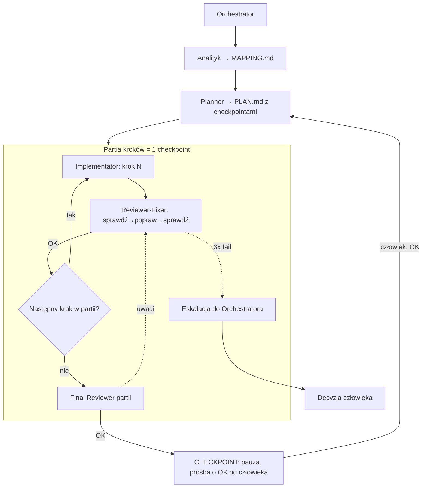

# PROCESS.md — Konstytucja migracji myGym (React Native + Expo → Angular)

> Dokument statyczny. Czytany przez wszystkich agentów. Definiuje JAK pracujemy.
> Nie zawiera stanu migracji (ten żyje w STATE.md) ani decyzji (DECISIONS.md).

## 1. Cel

Przepisać aplikację myGym z React Native + Expo na Angular, zachowując
zachowanie funkcjonalne. Źródło: to repo (READ-ONLY). Cel: `../myGym-angular`
(osobny folder, obok repo źródłowego).

## 2. Zasady naczelne

- Zachowanie funkcjonalne > wierność implementacji. Tłumaczymy KONCEPCJE, nie linie.
- Małe, testowalne kroki. Każdy krok kończy się zielonym buildem/testem.
- Jedno źródło prawdy: konwencje w MAPPING.md, postęp w STATE.md.
- Agenci nie rozmawiają bezpośrednio — komunikują się przez pliki (wzorzec blackboard).
- Język: identyfikatory i nazwy w kodzie po angielsku; komentarze po polsku;
  komunikacja z człowiekiem po polsku.

## 3. Role

| Rola           | Plik agenta             | Odpowiedzialność                                                                   | Pisze                  | Czyta         |
| -------------- | ----------------------- | ---------------------------------------------------------------------------------- | ---------------------- | ------------- |
| Orchestrator   | orchestrator.agent.md   | Dyryguje przepływem, odpala subagentów, obsługuje checkpointy i eskalacje          | STATE.md               | wszystkie     |
| Analityk       | analityk.agent.md       | Inwentaryzacja repo + mapowanie RN→Angular + struktura docelowa                    | MAPPING.md             | repo źródłowe |
| Planner        | planner.agent.md        | Graf kroków (DAG) + kryteria akceptacji per krok + podział na checkpointy          | PLAN.md                | MAPPING.md    |
| Implementator  | implementator.agent.md  | Wykonuje JEDEN krok planu w repo docelowym                                         | kod, STATE.md          | PLAN, MAPPING |
| Reviewer-Fixer | reviewer-fixer.agent.md | Sprawdza krok (build/lint/test) → poprawia → sprawdza ponownie, w pętli; commituje | kod, STATE.md          | PLAN, kod     |
| Final Reviewer | final-reviewer.agent.md | Całościowa weryfikacja po checkpoincie/migracji (świeże oko)                       | STATE.md, DECISIONS.md | całość        |

## 4. Przepływ



## 5. Definicja „DONE" (per krok)

Krok jest ukończony, gdy SPEŁNIA WSZYSTKIE kryteria z jego sekcji w PLAN.md.
Minimalny, zawsze obowiązujący zestaw:

1. `ng build` (lub `tsc --noEmit`) przechodzi bez błędów.
2. Linter nie zgłasza nowych błędów.
3. Testy jednostkowe kroku (jeśli krok je definiuje) są zielone.
4. Zachowanie zgodne z opisem w PLAN.md (lista kryteriów funkcjonalnych).
5. Brak `any`, brak martwego kodu, zgodność z konwencjami z MAPPING.md.
6. Zmiany zacommitowane w repo docelowym wg konwencji z sekcji 12.

Reviewer-Fixer sprawdza PRZECIWKO tej liście, nie „na oko".

## 6. Pętla Reviewer-Fixer i eskalacja

- Reviewer-Fixer iteruje: uruchom narzędzia → jeśli czerwone, popraw → uruchom ponownie.
- Limit: **3 pełne iteracje**. Po 3 nieudanych → STOP i eskalacja do Orchestratora.
- Eskalacja = wpis w STATE.md (status `blocked`, powód) + Orchestrator pyta człowieka.
- Nie wolno „obchodzić" kryteriów (np. wyłączać reguł lintera, dodawać `// @ts-ignore`).

## 7. Checkpointy (przebieg pół-automatyczny)

- Planner dzieli kroki na **3-4 partie** (checkpointy), wg warstw zależności:
  - CP1: rdzeń bez UI (modele, dane seed, czyste funkcje, storage).
  - CP2: logika (serwisy/stan, odpowiedniki hooków).
  - CP3: komponenty UI.
  - CP4: routing + spójność całości.
- W obrębie partii kroki lecą automatycznie (Implementator ↔ Reviewer-Fixer).
- Po Final Review partii Orchestrator **zatrzymuje się i prosi człowieka o OK**.
- Człowiek akceptuje → kolejna partia. Nie akceptuje → uwagi wracają do pętli.

## 8. Równoległość

- Kroki wykonujemy zgodnie z grafem zależności (DAG) z PLAN.md.
- Kroki „liściaste" bez wzajemnych zależności (np. różne modele) mogą iść równolegle.
- Kroki zależne (serwis → komponent → routing) — sekwencyjnie.
- Implementator NIGDY nie importuje czegoś, czego krok-zależność nie oznaczył jako DONE.

## 9. Pliki współdzielone (blackboard)

| Plik         | Kto pisze                       | Zmienność        |
| ------------ | ------------------------------- | ---------------- |
| PROCESS.md   | człowiek                        | statyczny        |
| MAPPING.md   | Analityk                        | raz, potem stały |
| PLAN.md      | Planner                         | rośnie           |
| STATE.md     | wszyscy                         | ciągle           |
| DECISIONS.md | wszyscy (gdy niejednoznaczność) | rośnie           |

## 10. Konwencje wpisu w STATE.md

Każdy krok ma status: `todo | in-progress | review | blocked | done`.
Wpis zawiera: id kroku, status, wykonawca, timestamp, hash/nazwa commitu, notatka/eskalacja.

## 11. Czego agentom NIE wolno

- Modyfikować repo źródłowego (RN) — jest READ-ONLY (tylko odczyt).
- Pomijać kryteriów akceptacji ani limitu 3 iteracji.
- Podejmować cichych decyzji architektonicznych — niejednoznaczność → wpis w DECISIONS.md + eskalacja.

## 11a. Co agentom WOLNO (narzędzia)

- Uruchamiać `ng`, `npm`, `npx`, testy i linter — ale TYLKO w repo docelowym (`../myGym-angular`).
- Reviewer-Fixer MUSI uruchamiać build/lint/test jako „ground truth" — opinia modelu nie wystarcza.
- Zapisywać kod i commitować w repo docelowym wg konwencji z sekcji 12.
- Pracować bez per-edit „OK" od człowieka — punktami kontroli są checkpointy (sekcja 7).

## 12. Commity w repo docelowym (`../myGym-angular`)

- Każdy ukończony krok (status `done`) = jeden commit.
- Format: `Migration-AI-step-NNN-krotki-opis-kebab-case`
  - `NNN` — trzycyfrowy, sekwencyjny numer kroku z PLAN.md (000, 001, 002…).
  - opis — zwięzły, po angielsku, kebab-case.
- Numeracja jest GLOBALNA i rosnąca przez całą migrację (nie resetuje się per checkpoint).
- Kto commituje: Reviewer-Fixer PO zatwierdzeniu kroku (gdy build/test zielone) — „pieczątka jakości".
- Po zamknięciu całej partii (checkpoint) — dodatkowy commit znacznikowy:
  `Migration-AI-checkpoint-CPx-nazwa` (np. `Migration-AI-checkpoint-CP1-core-no-ui`).
- Commit message (body) zawiera: id kroku, kryteria spełnione, pliki zmienione.

### Przykład sekwencji

```
Migration-AI-step-000-prepare-plan
Migration-AI-step-001-init-angular-repo
Migration-AI-step-002-migrate-models
Migration-AI-step-003-migrate-seed-data
Migration-AI-step-004-migrate-filter-exercises
Migration-AI-checkpoint-CP1-core-no-ui
Migration-AI-step-005-...
```
